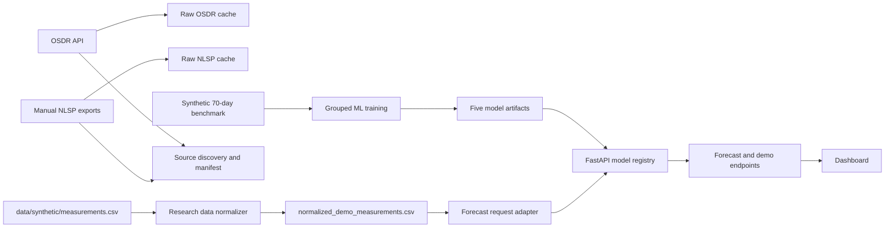

# Unified AstroGuard demo architecture

The repo now has one executable path across collection, processing, model use, API, and dashboard. Modules remain separated by responsibility; the unified command and API connect them.

## Unified local run

From `backend/`, run `python -m ml.pipeline --offline` to normalize the checked-in long-form demo measurements, prepare the synthetic ML training corpus, train the four system forecasters and anomaly detector, and write a run manifest. Without `--offline`, the same command first attempts OSDR collection and scans for local NLSP exports.

The `/api/v1/ml/forecast-from-dataset/{astronaut_id}` endpoint uses the same daily normalized rows that the pipeline writes. `/api/v1/ml/data-status` reports the collection, processing, and serving states. The static dashboard is served by FastAPI at `/dashboard`, so it shares the backend origin and needs no separate CORS configuration or frontend package install.

## Source boundaries

OSDR and NLSP exports have study-specific layouts and study populations. They are downloaded or discovered as raw files; there is no generic conversion from those files into astronaut daily labels. The checked-in long-form demo file uses a reviewed mapping for the variables and units it actually contains. Unsupported measures remain null. Training is still restricted to the separate, explicitly synthetic, complete 70-day benchmark because the collected research inputs do not provide compatible forecasting labels.
